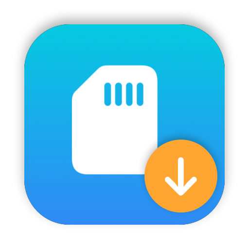

# CullCopy



SDカードの写真・動画を、撮影日ごとのフォルダに振り分けてコピーする macOS アプリです。無料で使えます。

## ダウンロード

[Releases](https://github.com/imblacksteel-ai/photo-manager/releases/latest) から `CullCopy-<バージョン>.dmg` をダウンロードして開き、「CullCopy」を「アプリケーション」フォルダにドラッグしてください。

- macOS 14 以降（Intel / Apple シリコン）
- Apple の公証済みなので、そのまま開けます

## できること

- **コピー元の選択**：接続中のSDカード・外付けドライブを一覧から選択（カードを差すと自動で選ばれます）。普通のフォルダも選べます
- **フォルダ名の形式を自由に指定**：`yyyy/yyyy年MM月dd日` のように書くと、撮影日で置き換えます
- **進捗の表示**：件数・進捗バー・コピー中のファイル名。メニューバーにも「12/340 残り328」のように表示。途中でキャンセルも可能
- **完了の通知**：終わると通知を出し、Dock のアイコンに ✓ を付けます
- **取り込み済みはスキップ**：コピー先に同名・同サイズのファイルがあればコピーしません。同名で中身が違う場合は `IMG_0001-1.JPG` のように別名で保存します
- **安全なコピー**：一時ファイルにコピーし、ディスクへ確実に書き込んでから中身（SHA-256）を照合して、正式な名前にします。途中で止まっても、もう一度「開始」を押せば続きからコピーできます
- **履歴**：いつ・どこからどこへ・何件中何件成功して何件残ったか・拡張子ごとの件数を記録します（ファイル名は記録しません）。保存場所は `~/Library/Application Support/SDImporter/history.json`
- **コピー元の削除（任意）**：完了後に「コピー元フォルダを削除しますか？」と確認。コピー先に同じ中身（SHA-256）で存在するファイルだけを削除します

- **重複チェック**（別タブ）：指定フォルダ内で中身が完全に同じファイルを探して一覧表示します（すべての種類のファイルが対象。削除や移動はしません）。重複したファイルはサムネイルで表示し、「並べて比較」で大きく並べて名前・場所・日付を見比べられます。チェック結果の概要は履歴に残り、前にチェックしたフォルダを選ぶと前回の結果を表示して再チェックするか確認します

- **選んでコピー**（別タブ）：選んだフォルダ（複数可）の写真を一覧で表示し、大きなプレビューで1枚ずつ見ながら「コピーして次へ」で指定のフォルダにコピーします（← → で移動、Return でコピー）

### フォルダ名の書き方

| 記号 | 意味 | 例 |
|---|---|---|
| `yyyy` | 年 | 2026 |
| `yy` | 年（2桁） | 26 |
| `MM` | 月 | 08 |
| `dd` | 日 | 15 |
| `/` | サブフォルダの区切り | |

大文字・小文字は区別しません。空欄にするとフォルダ分けしません。

| 入力 | 結果 |
|---|---|
| `yyyy/yyyy-MM-dd` | `2026/2026-08-15/` |
| `yyyy年MM月dd日` | `2026年08月15日/` |
| `yyyy_mm_dd` | `2026_08_15/` |

### 撮影日の判定

写真は EXIF の撮影日時、動画はファイル内の作成日時を使い、どちらも無ければファイルの作成日を使います。

### 対象のファイル

- 写真：jpg, jpeg, heic, heif, png, tif, tiff, dng と各社の RAW（arw, cr2, cr3, nef, orf, raf, rw2 など）
- 動画：mp4, mov, m4v, avi, mts, m2ts, 3gp, mxf, insv, lrv

## ビルド

macOS 14 以降、Xcode（Swift 6）が必要です。

```bash
./build.sh
```

`build/CullCopy.app` を作り、`/Applications` にも自動でコピーします（Launchpad やスポットライトから起動できます）。アプリが起動中なら、終了して入れ替えたあと起動し直します。

`./build.sh --no-install` なら `build/` に作るだけで、`/Applications` のアプリには触りません。

アイコンを作り直すときは `swift scripts/make_icon.swift` を実行してからビルドしてください。

## リリース

| 配布先 | 手順 | コマンド |
|---|---|---|
| GitHub Releases（公証済み .dmg） | [docs/release.md](docs/release.md) | `scripts/release.sh 1.0.0` |
| Mac App Store（サンドボックス・チップはアプリ内課金） | [docs/appstore.md](docs/appstore.md) | `scripts/appstore.sh 1.0.0` |

App Store 版は `project.yml`（XcodeGen）から作る Xcode プロジェクトでビルドします。スクリーンショットは `scripts/make_screenshots.sh` で作れます。

## 対応言語

日本語・英語・韓国語・中国語（簡体字・繁体字）。Mac の言語設定に合わせて切り替わります（それ以外の言語では英語）。アプリごとの言語は「システム設定」→「一般」→「言語と地域」→「アプリケーション」で変えられます。

画面の文言を追加・変更したら、`scripts/translations.py` の翻訳表に追記して次を実行してください（翻訳が足りない文言があると一覧を表示します）。

```bash
./scripts/update_strings.sh
```

## 構成

| ファイル | 内容 |
|---|---|
| `Sources/SDImporter/SDImporterApp.swift` | 画面 |
| `Sources/SDImporter/AppState.swift` | SDカードの検知・設定・コピーの進行管理 |
| `Sources/SDImporter/Importer.swift` | ファイルの走査・撮影日の取得・コピー・削除 |
| `Sources/SDImporter/FolderFormat.swift` | フォルダ名の形式の変換 |
| `Sources/SDImporter/History.swift` | 履歴の記録と保存 |
| `Sources/SDImporter/HistoryView.swift` | 履歴の画面 |
| `Sources/SDImporter/DuplicateFinder.swift` | 重複ファイルの検出 |
| `Sources/SDImporter/DuplicateView.swift` | 重複チェックの画面 |
| `Sources/SDImporter/PickCopy.swift` | 選んでコピー（一覧・大きなプレビュー） |
| `scripts/make_icon.swift` | アイコンの生成 |
| `scripts/translations.py` | 翻訳表（英語・韓国語・中国語） |
| `Resources/Localization/` | 翻訳ファイル |
| `scripts/release.sh` | 配布用 .dmg の作成・公証・公開 |
| `scripts/appstore.sh` | App Store 版のビルドとアップロード |
| `scripts/make_screenshots.sh` | App Store 用スクリーンショット |
| `scripts/asc_setup.py` | App Store Connect の掲載情報・スクリーンショット・価格・チップを API で登録 |
| `scripts/asc_token.swift` | App Store Connect API のアクセストークン（キーチェーンの API キーから作る） |
| `project.yml`・`AppStore/` | App Store 版の設定・掲載文 |
| `Sources/SDImporter/FolderAccess.swift` | サンドボックスでのフォルダ・SD カードへのアクセス |
| `Sources/SDImporter/Support.swift` | 「開発を支援する」（App Store 版のチップ） |

## ライセンス

[MIT](LICENSE)
